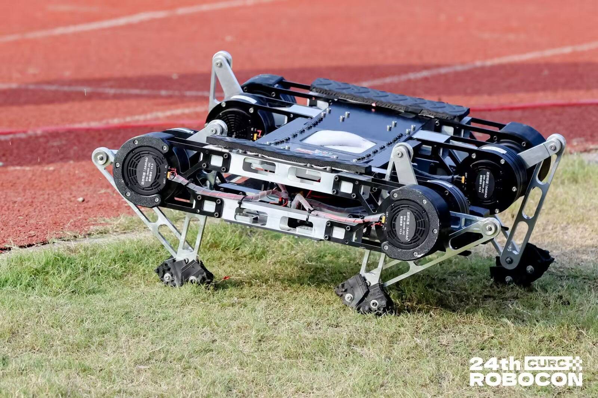

# ROBOOCN2025-8009DOG

> 苏州工学院 2025赛季足式机器人（二队）项目开源整理
> 
> 

## 简介

本仓库是**苏州工学院 ROBOCON 2025 足式机器人二队**的软件、控制方案与配套资料归档整理。 2025赛季是我校首次登上 ROBOCON 赛场，具备重要纪念意义。

> 说明：我本人为**2026赛季电控组成员**，并未参与2025赛季的开发工作，仓库内原有代码未做功能修改，仅做归档、梳理、整理，目的是给其他参赛队伍提供思路参考。
> 
> 

2025赛季成绩：**三项项目均获得全国二等奖（国二）**

核心技术方向：

- 足式机器人运动控制

- 机身位置控制

- 小陀螺、IKUN模式（仅供娱乐）

## 演示

b站：

- [RC马术比赛（马术群评比视频）\-22号作品](https://www.bilibili.com/video/BV1bob8zoEhs/?spm_id_from=333.337.search-card.all.click&vd_source=4f07d0682bac8028161eae946482de58)

- [25\-RC马术群机器人top10\-10](https://www.bilibili.com/video/BV171ekzHEKm/?buvid=XU7BB1878C6E81B10B2D7EEE992B78A7A5B3A&from_spmid=search.search-result.0.0&is_story_h5=false&mid=fZWlB3a2%2BVuaZQOcvtVIO38FTQ%2FSZMtL1rElX6M3iMo%3D&plat_id=114&share_from=ugc&share_medium=harmony&share_plat=harmony&share_session_id=926ee987-9284-49f2-bf1d-f34ad3fde5d3&share_source=COPY&share_tag=s_i&timestamp=1785136631&unique_k=CK9V9rV&up_id=447311406&vd_source=4f07d0682bac8028161eae946482de58)

- [R\&A战队勇闯Robocon喜获国二](https://www.bilibili.com/video/BV1jAtZzyECV/?spm_id_from=333.1387.upload.video_card.click&vd_source=4f07d0682bac8028161eae946482de58)

- [R\&A战队勇闯Robocon喜获国二](https://www.bilibili.com/video/BV1c9tozDEPm/?spm_id_from=333.1387.upload.video_card.click)

图片直播：

- https://alltuu\.cc/album/73a32108739142c368e1fa39230fa9c4/?menu=live

## 仓库目录结构
| 目录 | 说明 |
| --- | --- |
| `1.Software/` | 完全下位机（STM32F427，Keil uVision 工程：[`robohorse2022.uvprojx`](<./1.Software/DM8009DOG/project_8009/robohorse2022/MDK-ARM/robohorse2022.uvprojx>)|
| `2.Document/` | 资料与手册（PDF） |
| `3.Video/` | 视频 |
| `3.Images/` | 比赛图片 |
| `assets/` | README 图片素材 |

## 快速开始

### 下位机 Keil 工程

打开 [`1.Software/DM8009DOG/project_8009/robohorse2022/MDK-ARM/robohorse2022.uvprojx`](https://github.com/Childhood-zml/ROBOCON2025-8009DOG/blob/main/1.Software/DM8009DOG/project_8009/robohorse2022/MDK-ARM/robohorse2022.uvprojx)

> 环境建议：Keil uVision5，适配 STM32F427 芯片，配套 DJI 3508 电机驱动
> 
> 

## 重要声明

由于整理者并非2025赛季原开发队员，部分原始设计文档、调试日志、内部说明存在缺失，资料排布也可能不够规整，敬请谅解。 如果有疑问，欢迎在 Issue 中交流讨论。

## 致谢 \& 参考开源

项目方案参考（在此特别感谢宁波工程学院的开源）：

- [https://gitee\.com/Ha\-WthorN/robocon\-nbut](https://gitee.com/Ha-WthorN/robocon-nbut)

- [https://gitlab\.com/nbutroboticslab/Competition\_Projects/robocon/robocon2022](https://gitlab.com/nbutroboticslab/Competition_Projects/robocon/robocon2022)

仓库文档框架参考：

- [https://blog\.csdn\.net/weixin\_52612260/article/details/134124028](https://blog.csdn.net/weixin_52612260/article/details/134124028)

- [https://blog\.csdn\.net/Hbutneymar/article/details/147161479](https://blog.csdn.net/Hbutneymar/article/details/147161479)

资料参考：

- [【必读】LocoWiki介绍](https://lain-database.feishu.cn/wiki/HwyJwB70niKbW7khmwlcbCH2nXb)

## 许可声明

本仓库当前未附带 `LICENSE` 文件；如需在论文/商业项目中使用，请先联系作者确认授权范围。

